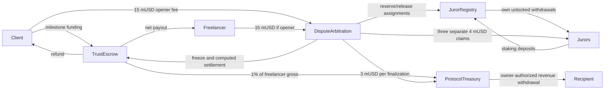

# Phase 2E: protocol integration, deployment verification and frontend readiness

Phase 2E verifies the five production contracts together, executes the real Ignition CLI against fresh local HTTP nodes, and exports a typed contract integration package. No Solidity contracts, economic parameters, existing deployment modules or earlier tests are changed. No frontend or backend is implemented.

The reviewed sources include AGENTS.md, all production contracts/interfaces, Phase 1-2D deployment modules, existing test suites and phase documentation. The full Solution Design Document referenced by the roadmap remains unavailable in this repository. The existing source and approved phase rules govern this work. Review and automated verification are not an independent security audit or a production-safety claim.

## Final architecture



MockUSD is the immutable six-decimal payment/staking token throughout. Escrow principal, registry collateral, arbitration fee/reward reserves and treasury revenue occupy separate contract balances. This phase preserves 1-5 sequential milestones, 7-day acceptance, 48-hour delivery grace, 72-hour review, 12-hour response, 24-hour voting, two-vote majority, 50/50 fallback, 100 mUSD assignment locks and the approved fee split.

## Deployment order and one-time dependencies

The authoritative complete module remains `ignition/modules/Phase2D.ts`:

1. Deploy MockUSD with local account zero as initial holder.
2. Deploy ProtocolTreasury(token, owner) and JurorRegistry(token). These independent deployments may be scheduled in either order by Ignition.
3. Deploy TrustEscrow(token, treasury). Treasury must exist so escrow can detect its ERC-165 intake interface and validate its token.
4. Deploy DisputeArbitration(escrow, registry). Both must exist, use the same token and have unconfigured arbitration addresses.
5. Treasury owner calls `configureSources(escrow, arbitration)` once.
6. Arbitration constructor caller calls `setProtocolTreasury(treasury)` once, after treasury source configuration and before the first dispute.
7. Escrow and registry constructor callers each call `setArbitrationContract(arbitration)` once. These calls depend on the arbitration address; opening remains blocked until every required binding is ready.

The module declares these dependencies correctly. No placeholder or unavailable address is passed to a constructor. Local account zero is the initial owner/configurator for the complete module. Roles are read back from contracts rather than guessed by the exporter.

`verifyDeployment` checks all token references, both arbitration authorizations, escrow/registry bindings, fee destinations, owner/configurators, the enabled treasury mode and every approved constant. It verifies deployed runtime bytecode against compiled artifacts, ignoring only compiler-declared immutable byte ranges. It checks that the four configuration events each occurred exactly once, then uses read-only calls from the authorized accounts to confirm that repeating configuration reverts with `InvalidState`.

Fresh verification additionally requires zero projects, disputes, registrations, liabilities, stakes, fee balances, reward reserves and treasury revenue. MockUSD's complete initial supply must still belong to the deployer. Thus a successful fresh export cannot silently reuse old funds or a partially configured legacy stack.

### Recovery and historical deployments

Re-running the same Ignition deployment journal on the same chain is verified to resume without mining more transactions or re-sending one-time setters. Interrupted deployment should be resumed using that same module, chain and deployment ID after inspecting `npx.cmd hardhat ignition status <deploymentId>`. A genuinely wrong irreversible binding requires a fresh stack; there is no administrator rebinding or fund sweep.

Phase1, Phase2B and Phase2C modules remain unchanged and are tested independently for their documented behavior. Phase1 uses the demo treasury wallet; Phase2B adds an unconfigured registry; Phase2C authorizes arbitration but retains dispute fees without enabling rewards. The frontend address exporter deliberately requires `TrustLayerPhase2D#...` identifiers and the full treasury-enabled configuration, so it will reject a legacy journal.

Old bytecode cannot be retrofitted. Existing Phase2C retained fees still have no migration path; no Phase 2E tooling attempts to transfer them. Starting a new local node also creates a new chain instance even when its chain ID and deterministic addresses match old values.

## Reproducing the verification

From the repository root, install locked dependencies with `npm.cmd ci` when needed. The implementation verification uses the currently installed locked toolchain; no dependency versions were changed.

```powershell
npm.cmd run compile
npm.cmd run export:abis
npm.cmd test
npm.cmd run typecheck
git diff --check
npm.cmd run verify:local
```

`verify:local` runs the actual Hardhat CLI, not an alternative deployment implementation. It starts a node at genesis on loopback port 18545, deploys Phase2D, validates and exports it, resumes the same journal, and validates that the resume mined no additional transactions. It stops that node and repeats the process with a second fresh node/journal. The two runs must produce identical addresses and runtime hashes. The verifier refuses an occupied port and stops only processes it created; it never attaches to or terminates an existing user's node. `TRUSTLAYER_VERIFY_PORT` can select another unused nonprivileged port.

The real child commands are equivalent to:

```powershell
npx.cmd hardhat node --hostname 127.0.0.1 --port 18545 --chain-id 31337
npx.cmd hardhat ignition deploy ignition/modules/Phase2D.ts --network localhost --deployment-id <unique-id>
npx.cmd hardhat run scripts/export-contracts.ts --network localhost --no-compile
```

The verifier supplies `LOCAL_RPC_URL`, the unique deployment ID and fresh/ephemeral flags to those child processes. It never uses a public network. Both owned nodes are stopped in cleanup, including on failure. Its public report is `reports/phase2e/verification.json`; deployment/export logs are in the same folder. Node logs contain Hardhat's known local demo-account output, are ignored by Git through `*.log`, and must never be copied into frontend configuration. No signer material is included in public reports or exports.

Reports live outside `artifacts/` because Hardhat rebuilds may remove non-artifact contents from that directory. This tooling issue was found and fixed during verification.

### Persistent local deployment for a future frontend

The verification manifest is explicitly ephemeral and its node is stopped. Create/export your own persistent instance before connecting a frontend.

Terminal 1:

```powershell
npm.cmd run node -- --hostname 127.0.0.1
```

Terminal 2:

```powershell
$env:LOCAL_RPC_URL = "http://127.0.0.1:8545"
$env:TRUSTLAYER_DEPLOYMENT_ID = "trustlayer-local"
$env:TRUSTLAYER_VERIFY_FRESH = "true"
npx.cmd hardhat ignition deploy ignition/modules/Phase2D.ts --network localhost --deployment-id trustlayer-local
npm.cmd run export:contracts
```

Hardhat reads `LOCAL_RPC_URL` from the process environment; `.env.example` is documentation, not automatic dotenv loading. For re-exporting a deployment after legitimate project activity, set `TRUSTLAYER_VERIFY_FRESH` to `false`; configuration and code checks still apply. Export requires a localhost HTTP connection and chain ID 31337. It rejects credentialed/non-loopback URLs and unsafe deployment IDs. It never guesses addresses or manually edits a journal. If transactions advance the chain during export, wait for them to settle and retry.

## ABI/address exports and naming

The private `@trustlayer/contracts` source package is under `packages/contracts/`:

| Location | Contents |
|---|---|
| `generated/abi/MockUSD.json` | Full compiled MockUSD ABI |
| `generated/abi/TrustEscrow.json` | Full compiled escrow ABI |
| `generated/abi/JurorRegistry.json` | Full compiled registry ABI |
| `generated/abi/DisputeArbitration.json` | Full compiled arbitration/reward ABI |
| `generated/abi/ProtocolTreasury.json` | Full compiled treasury/ownership ABI |
| `generated/abis.ts` | The same five ABIs as typed `as const` exports |
| `generated/inventory.json` | Every constructor, read, write, event and custom error with its real signature and ABI fields |
| `generated/deployments/31337.json` | Validated addresses, chain ID, public authorities, ABI/runtime hashes, verification block and provenance |
| `src/index.ts` | Validation and typed configuration helpers for Viem/Wagmi |

Names match Solidity: `MockUSD`, `TrustEscrow`, `JurorRegistry`, `DisputeArbitration`, `ProtocolTreasury`. TypeScript ABI names append `Abi`, such as `TrustEscrowAbi`. Native Ignition identifiers are `TrustLayerPhase2D#<ContractName>`. No test harness ABI or address is exported.

`export:abis` reads compiled Hardhat artifacts and generates only these five ABIs and the inventory. `export:contracts` first verifies the live deployment against those compiled artifacts, then writes the manifest and regenerates ABIs. The tests compare the delivered ABI JSON, typed ABI constants and inventory to the real compiler outputs, preventing silent ABI drift. After changing Solidity, compile and regenerate; changed deployed bytecode requires redeployment rather than an invented client-side method.

`parseLocalDeployment` rejects unsupported schema/module/chain, missing or duplicate/zero addresses, invalid hashes, ABI mismatches and invalid provenance. `getContracts(manifest, connectedWalletChainId)` returns typed `{ address, abi }` entries and rejects a mismatched wallet chain. `assertDeploymentOnChain(publicClient, manifest)` checks chain ID, the anchored verification block and each deployed runtime hash. It rejects a reset/empty chain or changed bytecode rather than trusting chain ID 31337 alone. The RPC and wallet must refer to the same active local chain instance.

Example integration fragment for a later frontend, not an application implementation:

```typescript
import { parseUnits, formatUnits } from "viem";
import deploymentJson from "@trustlayer/contracts/deployments/31337";
import { parseLocalDeployment, assertDeploymentOnChain, getContracts, TOKEN_DECIMALS } from "@trustlayer/contracts";

const deployment = parseLocalDeployment(deploymentJson);
await assertDeploymentOnChain(publicClient, deployment);
const contracts = getContracts(deployment, await walletClient.getChainId());
const stakeAmount = parseUnits("100", TOKEN_DECIMALS);
const tokenBalance = await publicClient.readContract({
  ...contracts.MockUSD, functionName: "balanceOf", args: [walletAddress],
});
const displayedBalance = formatUnits(tokenBalance, TOKEN_DECIMALS);
```

A later Next.js workspace may consume this source as a local workspace/package and transpile it. No app, wallet connector, backend or deployment auto-connection is added here. Manifest authorities are snapshots: mutable treasury ownership must be read live with `owner()` and `pendingOwner()`. Wallets need native local ETH for gas even though protocol amounts use mUSD.

## Read-only inventory

The complete, signature-accurate inventory is generated in `generated/inventory.json`. Principal reads are:

- MockUSD: `balanceOf`, `allowance`, `decimals`, `name`, `symbol`, `totalSupply`.
- TrustEscrow: `projects`, `milestones`, `getDisputeContext`, `nextProjectId`, `totalEscrowLiability`, `paymentToken`, `treasury`, `usesProtocolTreasury`, `arbitrationContract`, `arbitrationConfigurator`, and acceptance/grace/review/fee constants.
- JurorRegistry: `getJurorInfo`, `availableStake`, `isEligible`, `getAvailableJurors`, `previewJurors`, `getAssignment`, `isAssigned`, `getActiveDisputes`, registered-juror getters, `selectionCursor`, `availableJurorCount`, `totalStaked`, `totalLockedStake`, token/authorization getters and stake/jury constants.
- DisputeArbitration: `getDispute`, `getMilestoneDispute`, `getVerdict`, `votes`, `claimableReward`, `rewardClaimed`, `rewardsReserved`, `rewardsClaimedForDispute`, `reservedJurorRewards`, cumulative/pending fee and reward getters, `nextDisputeId`, contract/authority bindings, `isConfigured` and fee/time constants.
- ProtocolTreasury: `owner`, `pendingOwner`, `availableRevenue`, `totalRevenueReceived`, service/dispute/withdrawal counters, `serviceFeeReceived`, `disputeFeeReceived`, bindings, `supportsInterface` and the 3 mUSD constant.

`getVerdict` intentionally reverts before voting ends. Unknown case/project behavior differs by getter; use explicit existence/state reads and decode the actual custom errors rather than displaying default tuples as real records. Registry full-array reads are unbounded convenience methods: future applications should use events and indexed reads for large histories instead of polling all arrays.

## State-changing inventory, roles and allowances

| Contract methods | Authorized wallet/caller | ERC-20 allowance needed |
|---|---|---|
| MockUSD `approve` | Token owner granting a spender allowance | None |
| MockUSD `transfer` | Holder; also how the deployer supplies demo tokens | None; there is no public mint/faucet method |
| MockUSD `transferFrom` | Spender with holder allowance | Holder to spender |
| Escrow `createProject` | Client; freelancer must be a distinct nonzero address | None |
| Escrow `fundProject` | Recorded client, before acceptance expiry | Client to escrow for the full project total |
| Escrow `acceptProject`, `submitMilestone`, `releaseAfterReviewTimeout` | Named freelancer, with applicable state/deadline checks | None |
| Escrow `approveMilestone`, `refundMissedMilestone`, `refundUnaccepted` | Recorded client, with applicable state/deadline checks | None |
| Escrow `setArbitrationContract` | Immutable configurator; exactly once | None; deployment-only |
| Escrow `freezeMilestone`, `settleDisputedMilestone` | Configured arbitration contract only | No wallet call permitted |
| Registry `registerJuror` | Wallet registering itself once | None |
| Registry `depositStake` | Registered juror adding own stake | Juror to registry for the deposited amount |
| Registry `withdrawStake` | Juror withdrawing own unlocked stake | None |
| Registry `setArbitrationContract` | Immutable configurator; exactly once | None; deployment-only |
| Registry `reserveJurors`, `releaseJurors` | Configured arbitration contract only | No wallet call permitted |
| Arbitration `openDispute` | Project client or freelancer during the review window | Opener to arbitration for 15 mUSD |
| Arbitration `respondToDispute` | Participant other than opener, before response deadline | None |
| Arbitration `castVote` | Assigned juror, once, during voting | None |
| Arbitration `finalizeDispute` | Any wallet after voting deadline | None |
| Arbitration `claimJurorReward` | Assigned unclaimed juror on a finalized reserved case | None; pays only that caller |
| Arbitration `setProtocolTreasury` | Immutable constructor caller, once before first dispute | None; deployment-only |
| Treasury `configureSources` | Owner, exactly once | None; deployment-only |
| Treasury `depositServiceFee`, `depositDisputeFee` | Pinned escrow/arbitration contract respectively | Exact fee approvals handled internally; no user approval |
| Treasury `withdraw`, `transferOwnership`, `renounceOwnership` | Current owner | None |
| Treasury `acceptOwnership` | Pending owner | None |

All mUSD amounts are six-decimal integer base units: 100 mUSD = `100_000_000n`, 15 = `15_000_000n`, 4 = `4_000_000n`, 3 = `3_000_000n`. Use Viem `parseUnits`/`formatUnits` and `bigint`; do not use `parseEther`, floating-point multiplication, or JavaScript numbers for uint256 IDs and token balances. Enum values returned as uint8 are numbers. Project states are UNFUNDED=0, FUNDED=1, ACTIVE=2, COMPLETED=3, CLOSED=4; milestone states are PENDING=0, SUBMITTED=1, DISPUTED=2, SETTLED=3. Dispute statuses are NONE=0, OPEN=1, FINALIZED=2; votes are NONE=0, FREELANCER_WINS=1, CLIENT_WINS=2, SPLIT=3.

## Workflows and expected transaction state changes

### Normal payment

The deployer transfers demo tokens to the client. `createProject` creates UNFUNDED escrow metadata with 1-5 sequential milestones. Client allowance followed by `fundProject` transitions to FUNDED and increases backed escrow liability. Named freelancer acceptance transitions to ACTIVE. Submission records a nonzero evidence reference hash and review deadline, making the current milestone SUBMITTED. Client approval pays freelancer net of 1% service fee, deposits that fee into treasury, reduces liability, marks SETTLED and advances the current milestone.

An `approve` transaction changes token allowance only; it does not itself fund, stake or open a dispute. Wait for a successful receipt, re-read allowance, then submit the dependent transaction. On a rejected/reverted transaction, refresh actual state and decode its custom error; do not optimistically invent a completed settlement.

### Complete dispute workflow

After normal settlement of milestone zero, freelancer submits milestone one. During review, either participant approves a 15 mUSD allowance and opens the case. Opening collects that fee, freezes the milestone, reserves three distinct eligible nonparticipant jurors and locks 100 mUSD from each atomically. Any failure, including insufficient jurors, restores the fee, allowance, freeze, case ID and locks.

The other participant may submit one response hash while `timestamp < responseDeadline`. Voting starts at `responseDeadline = openedAt + 12 hours` and is allowed through `votingDeadline = responseDeadline + 24 hours`, both voting boundaries inclusive. Only assigned jurors may cast one of the three nonempty ballots. Browser time is advisory; read chain timestamps and let contract checks determine eligibility.

When `timestamp > votingDeadline`, any wallet may finalize. Two identical ballots choose the ruling; otherwise fallback is 50/50, including missing votes. Finalization settles the selected escrow milestone, releases the three locks, deposits 3 mUSD to treasury and reserves 12 mUSD in arbitration. Each assigned juror, including abstainers, separately claims 4 mUSD. Claims require neither token allowance nor a treasury-owner action.

Every transaction should progress through wallet approval, submitted hash, successful/reverted receipt, then state refresh. The protocol has no cancellation, appeal, administrator verdict override, reward-redirection, emergency sweep or frontend-controlled settlement method.

### Events for transaction history

Use the complete generated event ABI, including indexed fields. Normal flow uses `ProjectCreated`, `ProjectFunded`, `ProjectAccepted`, `MilestoneSubmitted`, `MilestoneSettled` and `ServiceFeeDeposited`. Disputes add `DisputeOpened`, `DisputeFeeCollected`, `MilestoneFrozen`, `JurorAssigned`, `StakeLocked`, `DisputeResponded`, `VoteCast`, `VerdictReached`, `DisputeFinalized`, `DisputedMilestoneSettled`, `StakeUnlocked`, `AssignmentReleased`, `JurorRewardsReserved`, `ProtocolFeeDeposited`, `DisputeFeeDeposited` and `JurorRewardClaimed`. Ownership, withdrawal, staking, configuration and ERC-20 Approval/Transfer events are also exported.

Future indexing must identify logs by chain instance, transaction hash and log index, handle removed/reorged logs and avoid counting correlated escrow/arbitration settlement events as separate payments. That indexer is not implemented here.

## Accounting and end-to-end results

Scenario A funds a 400/600 mUSD project from a client starting with 2,000 mUSD. The first normal approval pays 396 to freelancer, deposits 4 service revenue, and leaves 600 principal/liability in escrow. Scenario B disputes the remaining 600 mUSD and pays the separate 15 mUSD opener fee.

| Second milestone result | Final client wallet | Final freelancer wallet | Total service revenue | Protocol dispute revenue | Total treasury revenue | Juror rewards |
|---|---|---|---|---|---|---|
| Freelancer victory | 985 | 990 | 10 | 3 | 13 | 12 |
| Client victory | 1,585 | 396 | 4 | 3 | 7 | 12 |
| Split majority | 1,285 | 693 | 7 | 3 | 10 | 12 |
| Three different votes / fallback | 1,285 | 693 | 7 | 3 | 10 | 12 |

Values are mUSD. All four workflows use production contracts deployed by the actual Phase2D module. Every transaction receipt is checked. At completion, escrow principal/liability and arbitration fee/reward custody are zero, all 300 mUSD assignment locks are released, juror deposits remain intact at 200 mUSD each, and all three juror wallets receive exactly 4 mUSD. The project's state is COMPLETED. Full token-supply conservation is asserted across deployer, client, freelancer, jurors and every custody contract.

The broader retained tests cover simultaneous projects/cases, partial refunds, service-fee/rounding rules, time boundaries, unauthorized calls, duplicate voting/settlement/claims, failed ERC-20 approvals/transfers, reentrancy, unclaimed rewards, two-step ownership and rollback/retry after late treasury failure. Phase 2D accounting invariants remain unchanged: principal/stakes/revenue/rewards are separately backed; each 15 mUSD opening is accounted for as held fees, successful reward claims and 3 mUSD treasury transfers.

Verification reports **156 passing Node.js tests: all prior 143 unchanged plus 13 Phase 2E tests**. Solidity compilation, TypeScript checking (including scripts/generated package) and whitespace checks pass. Two fresh local CLI deployments and two idempotent resumes pass; all five runtime bytecodes and contract references match, every one-time configuration event occurs once, fresh custody balances are zero, and both nodes are stopped. The checked-in manifest records the actual verified local addresses and is marked ephemeral.

## Security review and remaining known issues

No confirmed production-contract defect requiring a Solidity or economic change was found in this review/test scope. Findings and boundaries are:

| Area | Reviewed result / remaining risk |
|---|---|
| Reentrancy, unauthorized calls, double settlement/claim | Existing guarded value paths and role/state checks pass retained and integration tests; this is not an exhaustive proof |
| Principal, collateral, fee/reward conservation | Exact production-contract balances pass all four complete workflows and retained multi-case/fault tests |
| Initialization/recovery | Correct module dependencies and idempotent resume verified; wrong one-time bindings remain irreversible and require redeployment |
| Failed transfers/finalization denial of service | Failures revert all effects and can be retried; finalization still depends on functioning token/treasury intake and a transaction being submitted |
| Registry scaling | Core selection visits at most five currently eligible candidates; full-array/history views can become expensive and should not be polled unboundedly |
| Unclaimed rewards | Reserved indefinitely, with no expiry or sweep; lost keys leave rewards unclaimed |
| Jury selection and votes | Deterministic selection is predictable, manipulable through funded wallets/order, and not Sybil/collusion resistant; ballots are public, without commit/reveal |
| Owner authority | Owner controls recognized protocol revenue, not principal/collateral/rewards; key compromise exposes revenue, and inherited renunciation can permanently disable owner functions |
| Token/evidence | Only standard six-decimal MockUSD is supported; no private evidence storage/access control or availability guarantee is implemented |
| Local chain identity | Address files can become stale after reset despite the same chain ID/address pattern; block and runtime checks now reject stale instances |
| Old deployed contracts | Non-upgradeable; old retained Phase2C fees still have no recovery/migration path |

The ABI utility import was corrected to the installed Viem public utility entry point. Reports were moved out of the Hardhat-cleaned artifact directory. These were tooling fixes, not protocol changes. No checks were weakened or errors suppressed to pass verification.

The protocol and exported interfaces are ready for **reviewed local frontend development**, using a newly exported persistent local deployment. It is not audited, production-ready or authorized for real funds/public deployment. Remaining application work includes wallet/session handling, private evidence storage, transaction UX and resilient event indexing, all deferred until explicit Phase 3 approval. Stop after Phase 2E review.
